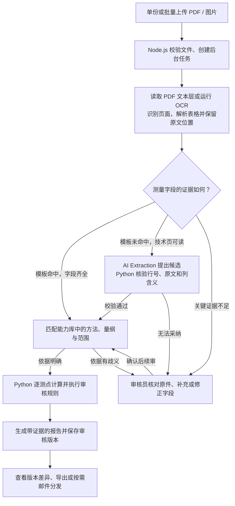
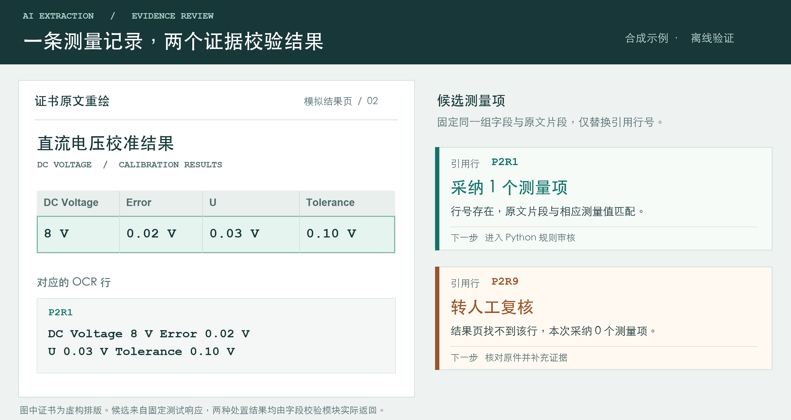

# Project 01｜企业级 AI 证书审核系统

一张校准结果表上，设定值、示值误差、不确定度和允差可能都用伏特表示。OCR 即使把每个数字都读对，一旦把数字填错列，后面的计算仍会失真。我把审核拆成三个可以分别验证的问题：**原件上写了什么、这个值属于哪个测量项目、现有证据能支持什么结论**。

系统支持单份和批量 PDF、扫描件上传。审核员可以查看逐测点的规则结果和原文证据，处理待复核项，比较续审前后的报告。后台将原件、解析结果和审核版本关联归档，并支持报告导出和邮件分发。

## 证书审核流程

审核员从网页上传文件后，可以用任务编号查看进度。Node.js 负责任务编排，Python 工作进程承担 OCR、结构化提取和规则计算，PostgreSQL 保存供服务查询的业务记录。一次人工修正可以沿同一任务重新匹配和审核，前后两个版本均可追溯。

## AI Extraction 如何处理陌生模板

上图重绘了一条虚构的 8 V 测量记录。为了单独验证系统怎样处理模型输出，我固定了候选字段、原文片段和置信度，只改引用行号。第一次校验采纳了测量项；第二次采纳数为零，并返回人工复核状态。两次都实际执行了字段校验，模型响应用测试数据代替。这项对照检验的是**系统能否拒绝没有出处的候选值**。

| 遇到的情形 | 我怎样分配任务 | 交给下一步的结果 |
| --- | --- | --- |
| 有可读文本或熟悉的版式 | 优先读 PDF 文本层；扫描页先用 RapidOCR，识别质量不足再用 PaddleOCR。按页面类型解析多层表头、无边框表格和跨页续表。 | 带页码、位置和列含义的字段及测量项 |
| 模板未命中，技术页仍有足够证据 | 从结果、技术依据或溯源页选择相关 OCR 行，过滤客户与签名信息。按证据质量和任务难度调用不同档位的 DeepSeek；限定可返回的字段和测量列。 | 带行号、原文片段和置信度的候选值 |
| 候选值需要核验 | Python 检查行号、原文、字段类型以及数值对应的列。单位恢复也要有明确原文；证据不足、返回格式异常或模型服务失败时交给人工。 | 可进入规则审核的结构化数据，或附原因的复核任务 |
| 同一器具匹配到多个能力条目 | 先按参数、方法、量纲和范围查能力库；有多个合理候选时才让模型在给定集合内排序。Python 核对适用范围、换算单位并逐测点计算。 | 附匹配依据的能力条目、误差与允差检查、校准和测量能力（CMC）核查 |

**一次模型调用成功，字段仍可能被拒绝。** 因此我分别记录网关成功率、耗时、Token 用量和候选转人工的比例。排查时可以区分模型服务响应慢、原文质量差和候选无法通过校验。审核员补充证据后，系统用修正后的输入续审，保留前后报告供比较。

## 两次修复如何验证

### 封面字段串行：从报告误报追到单元格边界

审核报告提示缺少型号，原 PDF 却印着型号。对照封面与解析结果后，发现相邻行被拼接，型号进入了出厂编号。修复集中在标签和单元格边界；若原件的编号本来就缺失，系统仍需提示。

用覆盖四种业务来源的 **20 份合成 PDF** 回放，从批量上传走到正式报告。型号和出厂编号均逐份与合成原件比对，并另外核对不应受影响的测点。

| 核对项 | 修复前 | 修复后 |
| --- | ---: | ---: |
| 型号与原件一致 | 0 / 20 | 20 / 20 |
| 出厂编号与原件一致 | 0 / 20 | 20 / 20 |
| 型号缺失误报 | 20 条 | 0 条 |

两版报告的 60 个测点逐项一致。这里的分母是这组专门复现问题的样本，衡量的是修复效果。

### 批次重叠变慢：从整批耗时追到签名识别进程

两批任务重叠时，签名阶段明显变慢。我先拆开排队、模型初始化、各签名角色识别和高分辨率重试的耗时。对同一原件的记录显示，签名排队均为零，新增时间主要出现在批准人识别。于是我保留四个任务并行，只改变每个签名进程使用的线程数。

| 服务器隔离回放，每种配置一轮 | 默认线程配置 | 每进程 2 线程 | 每进程 1 线程 |
| --- | ---: | ---: | ---: |
| 四个任务全部完成签名 OCR | 278 秒 | 179 秒 | 166 秒 |
| 回放期间整机 CPU 忙碌率 | 99.1% | 96.6% | 71.7% |
| 人工复核去向与历史记录一致 | 4 / 4 | 4 / 4 | 4 / 4 |

单任务对照中，2 线程更快。最终按负载切换：单份独立运行使用 2 线程，批次重叠时使用 1 线程。四任务回放的签名阶段耗时缩短约 **40.4%**；上传到正式报告的端到端耗时另行验收。

这次回放让我把“并发”拆成两个可单独调节的量：**一台主机同时处理几份证书**，以及**每个进程动用几个推理线程**。表中三轮的并发峰值均为四个任务。基于这次学习，我把下一组实验设计为固定每进程的线程数，再改变同时运行的任务数，在同一批输入上比较排队时间、整批耗时和复核去向。这样才能判断增加工作进程是否值得。

## 从运行环境到依赖核验

梳理部署方式时，我沿着一次上传追问：**哪一个进程接收请求？哪个 Python 环境真正加载 OCR？数据库驱动由谁安装？** 云虚拟机（CVM）提供 CPU、内存和操作系统，Node.js 与 Python 在各自的运行环境中执行。一次终端版本查询只能证明该终端选中了哪个程序。项目部署脚本还揭示了一个容易漏掉的依赖：Node.js 使用的 PostgreSQL 驱动 `node-pg` 由 Ubuntu 软件包提供。

我据此整理了下面的核查方法，供升级评审使用。生产软件物料清单（SBOM）和扫描结论仍需依据对应发布环境生成。

| 要回答的问题 | 核查方法 |
| --- | --- |
| Web 服务实际运行哪个 Node.js 版本？ | 从服务启动配置定位可执行文件，记录完整版本，再对照官方维护周期安排补丁或主版本升级。 |
| 哪些依赖会随发布进入运行环境？ | 从 OCR 工作进程使用的 Python 环境盘点识别库与推理引擎，用 `pip-audit` 核查已知问题。JavaScript 包按实际包管理器和锁文件选用 `npm audit` 或 `pnpm audit`。 |
| 如何覆盖项目锁文件以外的组件？ | 对虚拟机按主机包清单核查 Ubuntu 安装的驱动和系统库。若改为容器交付，则按镜像摘要识别并扫描对应构建。 |
| 如何让下一次评审复用结果？ | 用 CycloneDX SBOM 记录组件、版本和依赖关系，把盘点时间、发布版本和扫描报告关联起来。 |

参考资料：[Node.js 官方维护周期](https://nodejs.org/en/about/previous-releases) · [CycloneDX 软件物料清单](https://cyclonedx.org/capabilities/sbom/) · [PyPA 的 pip-audit](https://github.com/pypa/pip-audit)

## 我在项目中形成的工程优势

- **能给模型划定具体职责。** 我把表格理解交给 OCR、模板和语言模型配合完成，把数值计算交给可复算的规则；每一次自动采纳都要能回到原文。
- **能把业务误报变成回归样本。** 从报告找到错误字段，再回到原页定位解析边界。验证修复时，同时检查误报是否消失、真实缺失是否仍被提示，以及相邻测点有没有受到影响。
- **能在质量约束下调度算力。** 对单任务和重叠批次分别计时，比较线程配置时同步核对人工复核去向。性能改动因此有可复现的收益，也有明确的验收口径。

**主要技术**　Python、Node.js、PostgreSQL、RapidOCR、PaddleOCR、DeepSeek、GitHub Actions。

[返回作品集首页](README.md)
