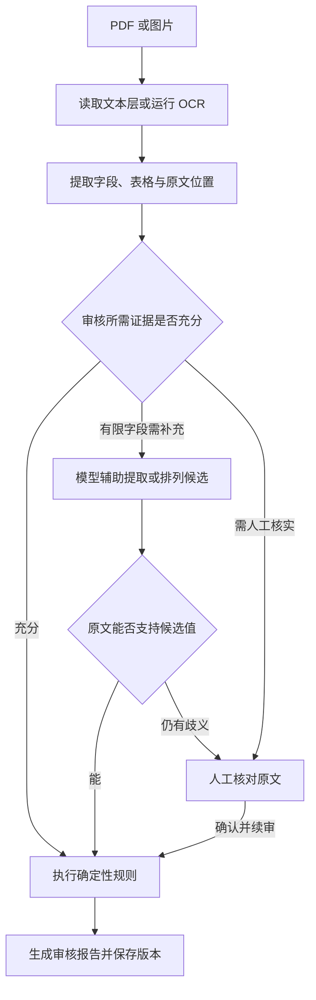

# Project 01｜企业级 AI 证书审核系统

校准证书可能是带文本层的 PDF，也可能是扫描件。审核员除了读出结果表中的数值，还要确认它对应哪一行、使用什么单位，以及该用哪条依据核验。系统把字段与原文位置一并保留，供后续计算和人工复核使用。

## 一处模糊的单位如何处理

下面以一份虚构的长度校准证书说明复核过程。

| 环节 | 示例中发生的事 | 留给审核员的依据 |
| --- | --- | --- |
| 提取 | OCR 读出结果值 12.50，扫描表头中的单位模糊 | 结果行与表头在原页的位置 |
| 待复核 | 单位尚待确认，依赖单位的检查暂缓 | 待确认字段及其对应的表格区域 |
| 人工确认 | 审核员核对原件，确认单位为 mm | 已确认的值及所依据的原文 |
| 续审 | 规则使用 12.50 mm 重新核验，生成新版本 | 可回看的审核结果与修正记录 |

**设计取舍。** 让语言模型协助解释表头或排列候选，可以处理不同证书的措辞差异。数值计算交给 Python 规则执行，使同一组已确认输入能够重复核验。证据不足时，系统把具体字段交给审核员，保留继续处理原任务所需的上下文。

## 实现与成果

文档处理使用 PDF 文本提取、RapidOCR 和 PaddleOCR，限定场景使用 DeepSeek 辅助提取或候选排序。系统通过 Node.js、Python 和 PostgreSQL 串联上传、后台处理、人工复核及报告归档。

已实现从单份或批量上传到报告归档的审核流程。回归验证关注修正后的字段能否进入后续计算，以及报告能否追溯至对应版本与原文。审核员可以从报告中的疑点回到证据位置，完成确认后继续处理同一份证书。

[返回作品集首页](README.md)
