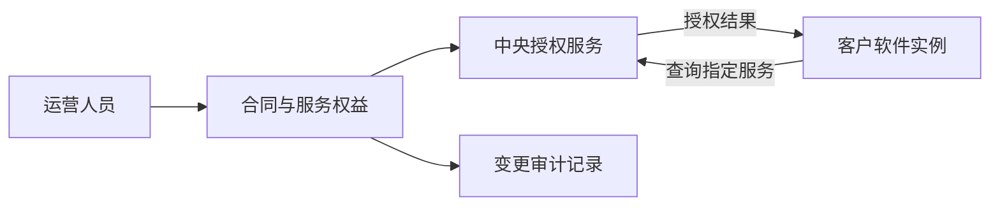

# Project 02｜中央授权管理平台

客户可以买断核心软件，按期订阅 AI 服务，并在自己的实例上使用两项功能。一个笼统的“客户已付费”标记无法回答具体请求：当 AI 订阅到期，客户还能使用哪些功能？

平台把客户、合同、服务权益和软件实例关联起来。运营人员在后台办理续费或暂停，业务实例通过授权接口询问某项服务当前是否可用。证书正文留在业务系统中。

## 一次续费会改变什么

以下使用两个虚构客户说明服务权益的粒度。甲买断了核心软件，乙按期租用核心软件，二者的 AI 订阅都已到期。

| 检查项 | 为甲续订 AI 前 | 续订成功后 |
| --- | --- | --- |
| 甲的核心软件 | 可用，买断 | 继续可用 |
| 甲的 AI 服务 | 已到期 | 在新订阅期内可用 |
| 乙的核心软件 | 在租期内可用 | 按乙的合同继续可用 |
| 乙的 AI 服务 | 已到期 | 仍已到期 |

**设计取舍。** 合同到期和人工暂停代表不同的事实。续费更新合同期限，恢复操作解除暂停。若某项服务在暂停期间完成续费，运营人员仍需显式恢复它。这也让审计记录能够回答两类问题：有效期何时变化，谁在何时恢复了服务。

## 实现与验证

管理界面使用 HTML、CSS 和 JavaScript，Node.js 服务提供 REST API，本地原型使用 SQLite。自动化用例覆盖双客户授权隔离、分项续费及暂停与恢复。对同一笔续费重复提交的测试，检查服务期限是否只延长一次。

已完成本地功能原型及协议层测试。公开案例的验证范围为本地环境。

[返回作品集首页](README.md)
