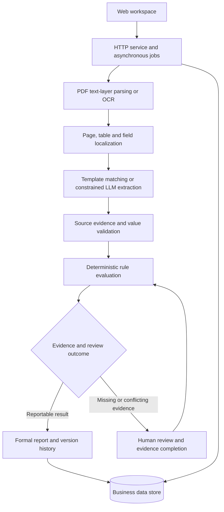

# Enterprise AI Document Intelligence & Automated Review

**Engineering case study | Full-stack AI applications · Intelligent document processing · Performance engineering**

A portfolio case study of an AI-assisted enterprise document review system for calibration and inspection certificates. It combines structured document extraction, evidence-grounded validation, deterministic checks and human review in an operational workflow.

This repository is a documentation-only portfolio. It does not distribute the underlying enterprise application, customer documents, proprietary business rules, or production data.

## 1. Project Overview

Calibration and inspection documents often contain inconsistent layouts, scanned pages, complex tables and measurements that must be interpreted in context. The project addresses these challenges by combining document intelligence with a traceable review process rather than relying on unrestricted model-generated decisions.

I independently took responsibility for application setup, front-end and back-end development, OCR and LLM integration, and optimization of the upload-to-report pipeline. I collaborated with domain specialists who owned the metrology-specific criteria and professional conclusions. The application has been deployed and used in an enterprise environment.

## 2. Conceptual Architecture

*Conceptual application workflow only; not a production network or infrastructure diagram.*

## 3. Technical Stack

| Area | Technologies and approaches |
| --- | --- |
| Front end | HTML, CSS, vanilla JavaScript |
| Back end | Node.js, HTTP APIs, Python, asynchronous job processing |
| Document intelligence | PDF text and coordinate parsing, RapidOCR, PaddleOCR fallback |
| LLM engineering | Constrained candidate extraction, evidence binding and validation |
| Data management | PostgreSQL, SQL migrations, report versioning |
| Engineering quality | Automated tests, fixture-based regression, stage-level performance analysis |
| Delivery | Linux, automated CI/CD and release validation |

## 4. Engineering Contributions

### End-to-end application development

Built the application workflow from authenticated upload and asynchronous processing through document parsing, field extraction, evidence validation, human review and report generation. Designed the interfaces between the web workspace, HTTP service, Python processing components and persistent business data.

### Hybrid document intelligence

Combined PDF text-layer parsing with OCR fallback and constrained LLM assistance. Addressed irregular layouts, complex headers, cross-page tables, numeric fields and column semantics. Bound candidate values to document evidence, then validated types, units and numerical values using deterministic processing.

### Reliable AI-assisted workflows

Used the LLM as a candidate extraction and ranking component rather than as the final authority on professional review decisions. Incorporated evidence validation, escalation to qualified human reviewers, subsequent review and report version history when information was insufficient or conflicting.

### Performance optimization

Used stage-level logs to identify processing bottlenecks under overlapping workloads. Distinguished document-level concurrency from inference-thread parallelism and evaluated alternative configurations using controlled replay inputs.

### Quality engineering and production delivery

Maintained fixed regression scenarios, synthetic ground-truth cases and targeted reprocessing checks. Used regression evidence and report comparisons to verify bug fixes, identify unintended changes, and support ongoing releases.

## 5. Selected Engineering Results

The following are scoped project measurements recorded by November 28, 2026. They are not system-wide accuracy or throughput guarantees.

| Metric | Recorded result | Evaluation scope |
| --- | --- | --- |
| Application scale | 9 core modules; 100 HTTP method/path combinations; approximately 40,000 effective application code lines | Project-level static inventory, not individual handwritten code or individual commits |
| Signature OCR elapsed time | 277.959 s to 165.566 s; **40.44% reduction** | Isolated server replay, four overlapping tasks, fixed inputs, one run per configuration |
| Host CPU busy rate | 99.1% to 71.7% | Same replay; review routing matched historical outcomes for all four tasks |
| Targeted false missing-model alerts | **20 to 0** | 20 synthetic PDFs with known cover-field values, before/after replay |
| Neighboring measurement points | 60/60 unchanged | Same synthetic regression; verifies the scoped side-effect check |
| Fixed regression scenarios | **126/126 passed** | Fixture-based suite; not a complete fresh OCR run for each scenario |
| Python automated tests | **963 passed, 0 failed, 1 skipped** | 964 listed tests in the recorded suite |

### Case study A — Concurrency and CPU resource optimization

**Problem:** A signature-recognition stage became a major processing bottleneck when document tasks overlapped.

**Approach:** Used stage-level timing to locate the bottleneck and evaluated inference-thread configurations independently of document-task concurrency. Fixed the workload at four tasks and compared the default, two-thread and one-thread configurations.

| Configuration | Signature OCR batch elapsed time | Host CPU busy rate |
| --- | ---: | ---: |
| Default | 277.959 s | 99.1% |
| Two threads per process | 179.404 s | 96.6% |
| One thread per process | 165.566 s | 71.7% |

**Result:** The one-thread configuration reduced the measured stage elapsed time by 40.44%. All four tasks retained their historical human-review routing. The CPU busy rate also decreased by 27.4 percentage points.

**Interpretation:** The result demonstrates a scoped performance improvement for the tested workload. CPU contention or thread oversubscription is a possible explanation, not a separately profiled causal finding. Repeated measurements would be needed before generalizing to other workloads or claiming a stable production latency improvement.

### Case study B — Evidence-grounded extraction and defect regression

**Problem:** A cover-field parsing defect produced false missing-model alerts despite model information being present.

**Approach:** Investigated the extraction boundaries and validated the correction against the same set of 20 synthetic PDFs with predefined model and serial-number fields. Checked neighboring measurement points and other warning outcomes for unintended changes.

**Result:** Targeted false missing-model alerts decreased from 20 to zero. Correct model and serial-number extractions each changed from 0/20 to 20/20. All 60 neighboring measurement points and other warnings across the 20 reports remained unchanged.

**Interpretation:** This is a targeted defect regression with known expected values, not a claim of perfect OCR accuracy or overall audit correctness.

## 6. Enterprise IT Collaboration and Security Planning

In collaboration with regional IT stakeholders at a multinational enterprise group, I contributed to a structured security assessment and phased remediation planning for the AI application. The work broadened the scope from feature delivery to enterprise identity, infrastructure reliability and responsible AI governance.

The assessment and planning covered:

- Enterprise identity federation, multi-factor authentication and role mapping, including an account-migration pilot design.
- Private network access, controlled deployment and rollback validation, and runtime compatibility planning.
- Dependency and vulnerability assessment, software inventory, and backup/restore validation planning.
- AI data-flow review, sensitive-data handling, privacy governance and access-audit requirements.

These are assessment and solution-design contributions. They do not imply that all proposed controls have been deployed, tested in production, or certified as compliant. Internal security findings, network details and remediation records are intentionally excluded from this case study.

## 7. Evaluation Boundaries

The reported performance results are based on specific recorded workloads and test conditions. They do not establish end-to-end audit accuracy, full-system precision or recall, stable production P95 latency, or labor savings compared with human-only review. Automated test results and targeted regression results should not be interpreted as independent professional sign-off or system-wide correctness.

## 8. Portfolio Summary

This project demonstrates my experience in:

- Full-stack development and end-to-end AI application engineering.
- Intelligent document processing and evidence-grounded LLM integration.
- Asynchronous workloads, performance diagnosis and resource optimization.
- Regression-driven quality engineering and production delivery.
- Enterprise IT collaboration and security solution planning.

The underlying enterprise implementation remains proprietary. This portfolio does not grant a license to its source code or internal materials. No runnable production application or customer data is included.
